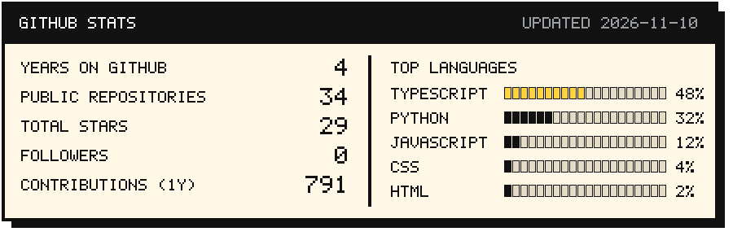

<p align="center">
  
</p>

<p align="center">
  <a href="https://cajucomportfolio.vercel.app/"></a>
  
</p>


```yaml
role:       Computer Science student
education:  BS Computer Science, specialization in Software Engineering, FEU Tech
location:   Manila, Philippines
languages:  Python, TypeScript
focus:      FastAPI, multi-agent tooling, edge computer vision, Raspberry Pi / Arduino
current:    Building the Ascend project series
```


<p>
  
  
  
  
  
  
  
  
  
  
  
  
  
</p>

## Certifications

### Professional

<p align="center">
  <a href="https://internship.flyrank.ai/verify/FR-D11-56722-B329D?first_name=Cyrill"></a>
  <a href="https://internship.flyrank.ai/verify/FR-D11-A9E5F-E68A6?first_name=Cyrill"></a>
  <a href="https://www.credly.com/badges/3318fc34-2d85-41db-85e4-ef2c0fc727b9"></a>
  <a href="https://www.credly.com/badges/a696c2ef-883c-4170-b81c-14a42787a711"></a>
  <a href="https://www.credly.com/badges/a522925b-00e3-404d-aa83-9a972fb3a8dd"></a>
  <a href="https://www.credly.com/badges/e733f033-0bf7-428b-b41a-354c50ad4899"></a>
</p>

### Claude Academy

<p align="center">
  <a href="https://academy.claude.com/verify/33af33deadedcfdbc288fd5403658dd8"></a>
  <a href="https://academy.claude.com/verify/10c579e002b4ca58eb0bc792bf832c27"></a>
  <a href="https://academy.claude.com/verify/8e77273ffb4eb4771031a1b06928f692"></a>
  <a href="https://academy.claude.com/verify/121239664057fa35d83db490eaffde23"></a>
  <a href="https://academy.claude.com/verify/00df819cd8f793402ac8a521e5a422d3"></a>
  <a href="https://academy.claude.com/verify/b55a1681bcb6bd5c4901f64fcea3e033"></a>
  <a href="https://academy.claude.com/verify/74a03fa1630f1b817b67898315cf045e"></a>
</p>

### Courses

<p align="center">
  <a href="https://www.linkedin.com/learning/certificates/3064eb85292f8849f8300b5b72d39011c33a77bea995cf6ddd8f7d6157b1880d"></a>
  <a href="https://www.linkedin.com/learning/certificates/b8f1aadc9227306f89f7288fde0d37574bef4c190d1789182859d30a53fdc61e"></a>
  <a href="https://cajucomportfolio.vercel.app/photos/certs/databricks-ai-agents.jpg"></a>
  <a href="https://www.kaggle.com/learn/certification/cyrillgerardcajucom/intro-to-deep-learning"></a>
  <a href="https://matlabacademy.mathworks.com/progress/share/certificate.html?id=4f37ec58-fd34-45e3-92fb-649652efded7"></a>
  <a href="https://cajucomportfolio.vercel.app/photos/certs/cisco-ccna-itn.jpg"></a>
  <a href="https://www.linkedin.com/learning/certificates/8eb3d916ea590ae8a1d07f910ac21602b64e59b5c914ddf699c899637890adc4"></a>
  <a href="https://www.linkedin.com/learning/certificates/5bc8460a0b9d56e77d4fdc51f4e20cb016fb940a99df59edb9f2166f122a7395"></a>
</p>


<p>
  <a href="https://github.com/cyrillcajucom/ascend-hub"></a>
  <a href="https://github.com/cyrillcajucom/ascend-core"></a>
  <a href="https://github.com/cyrillcajucom/ascend-vision"></a>
  <a href="https://github.com/sutayniee/Wake-Brake"></a>
  <a href="https://github.com/cyrillcajucom/Kinsenas-Collection-Agent"></a>
  <a href="https://github.com/cyrillcajucom/prescriptive-finance"></a>
</p>


<p>
  <a href="https://github.com/stars/cyrillcajucom/lists/flyrank"></a>
  <a href="https://github.com/stars/cyrillcajucom/lists/projects-prototypes"></a>
  <a href="https://github.com/stars/cyrillcajucom/lists/software-engineering-showcase"></a>
  <a href="https://github.com/stars/cyrillcajucom/lists/thesis"></a>
</p>





<picture>
  <source media="(prefers-color-scheme: dark)" srcset="https://raw.githubusercontent.com/cyrillcajucom/cyrillcajucom/output/snake-dark.svg">
  
</picture>

<a href="https://cajucomportfolio.vercel.app/"></a>
